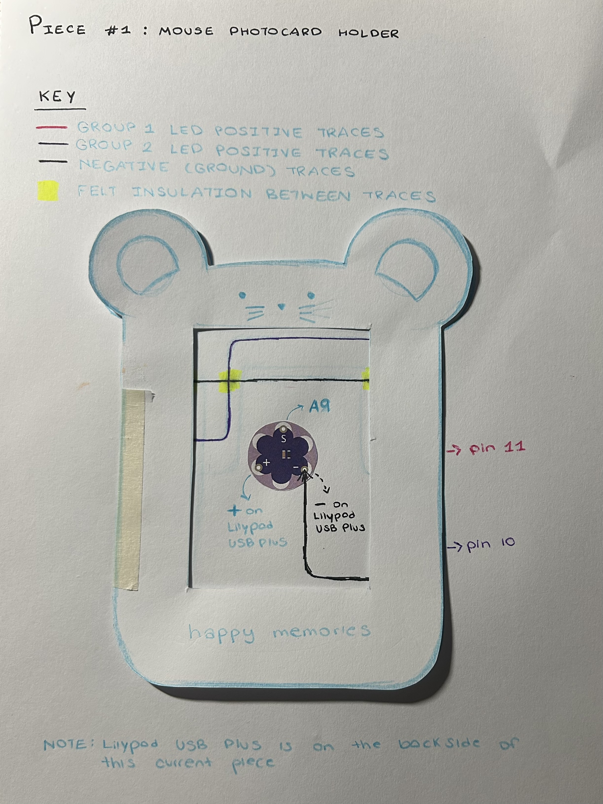
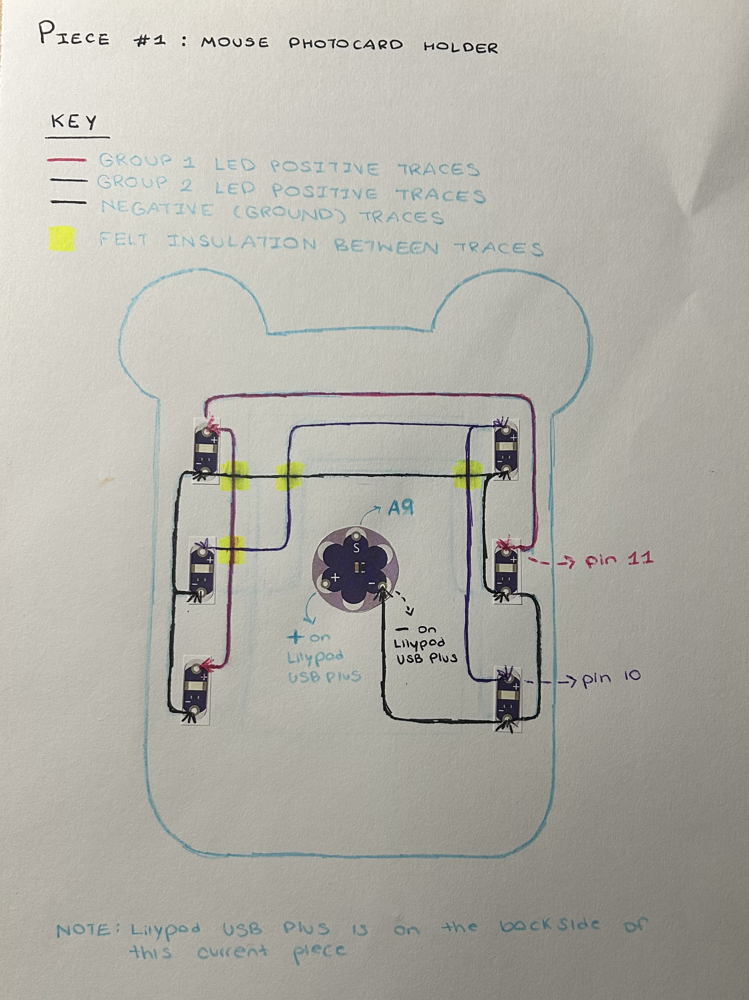
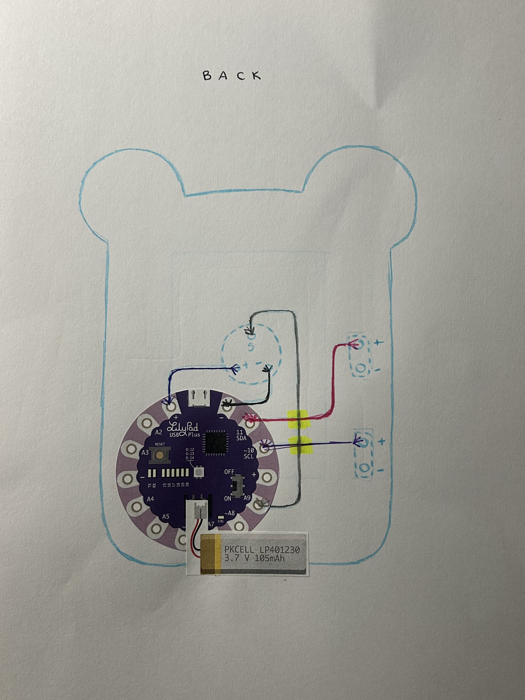
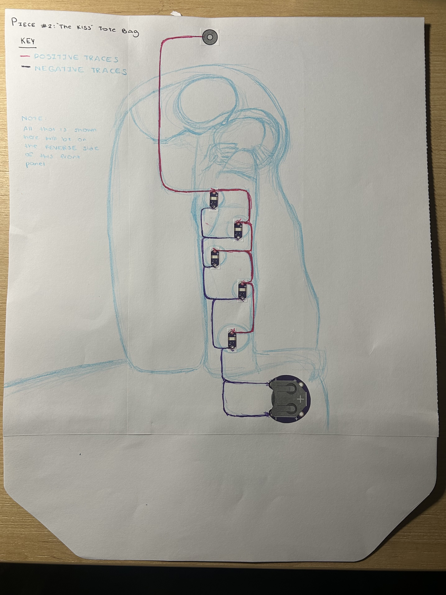
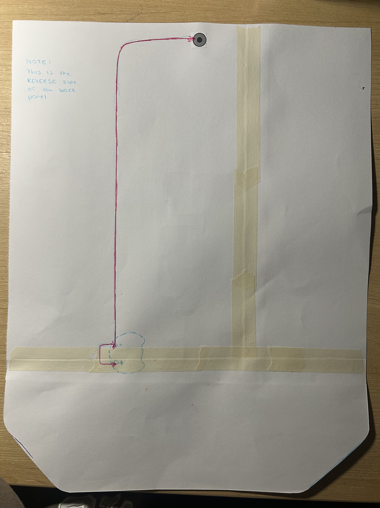
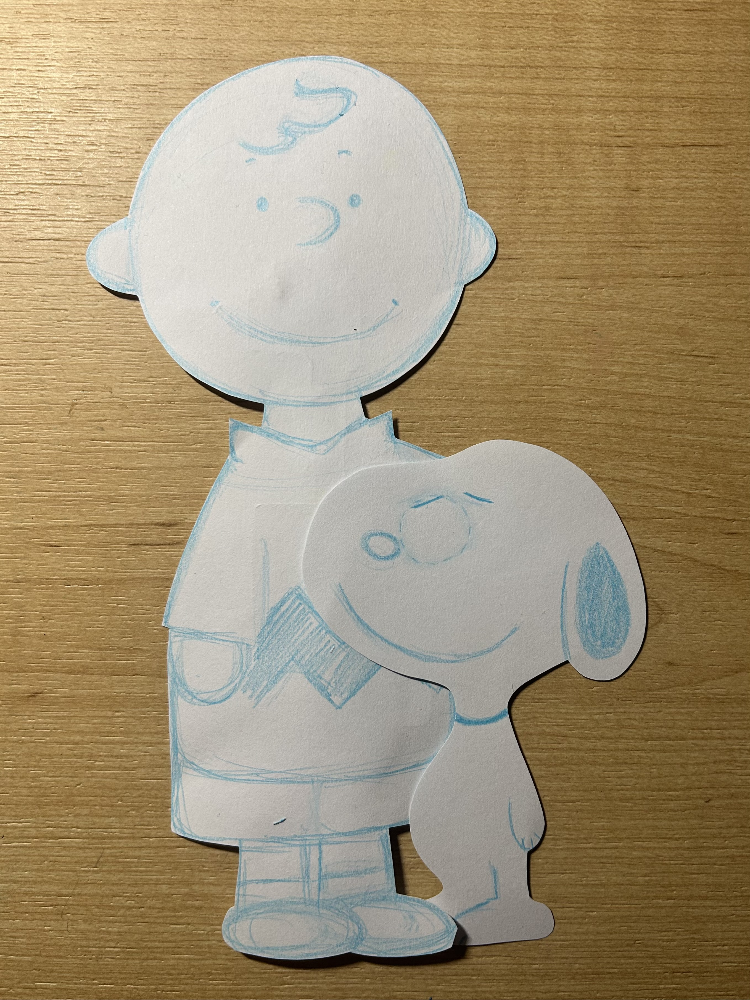
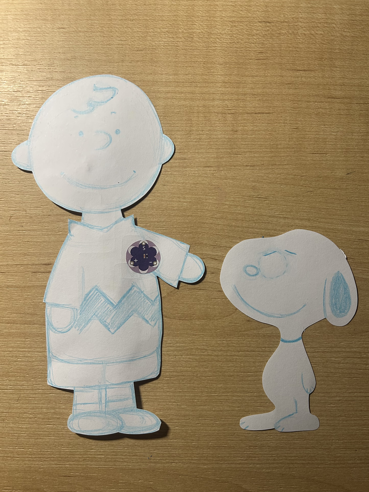
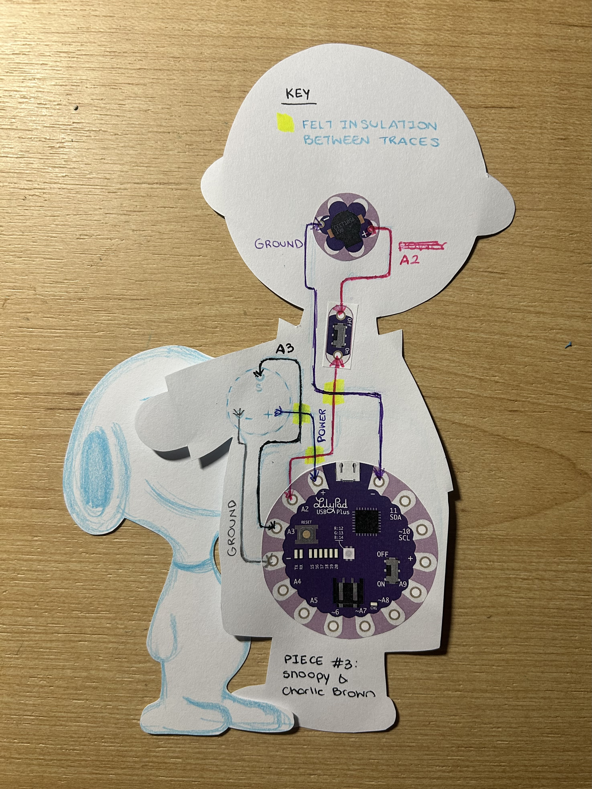

**Title of Project Collection:** Little Connections
*Description of Project Collection:* These three pieces are recreations of objects from my childhood, incorporating new knowledge of electrical components.

**PIECE #1: Mouse Photocard Holder**
*Description:* This mouse photocard holder will use a light sensor to detect if a photo is inserted or not. When the sensor detects darkness, it will trigger two sets of 3 LEDS, blinking at different rates.

**PIECE #2: "The Kiss" Tote Bag**
*Description:* This tote bag will be a felt and thread replica of the "The Kiss" piece by Gustav Klimt. There will be a metal snap at the top of the tote bag, simultaneously serving as a mechanism to hold the bag closed and to close the positive trace circuit. When the circuit is closed, the flowers on the woman's dress will light up.

**PIECE #3: Charlie Brown & Snoopy**
*Description:* These two characters will be on a felt background, attached with Velcro. When Snoopy moves to hug Charlie Brown, that will activate the light sensor, causing the buzzer to start playing the Peanuts theme song tune. There is also a switch incorporated into one of the traces of the buzzer so that Snoopy can hug Charlie Brown without the song playing.

