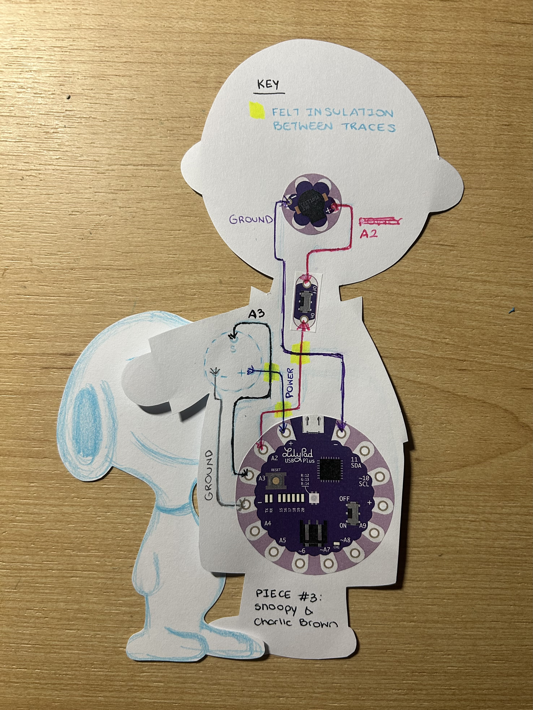

**Title: The Kiss Tote Bag**
Description: This tote bag depicts the famous *The Kiss* painting by Gustav Klimt. When you connect the two metal snaps
at the top together, it not only closes the tote bag shut but also lights up the flowers on the woman's dress. There
is a switch battery holder inside the tote bag so that the user can close the tote bag without the flowers lighting up if
he or she wishes. 

Motivation: I grew up with a photo of this painting in every house that I've lived in as it was one of my mother's favorite
pieces. Every time I look at this scene, it reminds me of my childhood. I have also developed a unique relationship with this
painting as I've grown with it, extrapolating it to relationships in my life. 

*Note: This piece is not fully finished. I still have to add a lot more details to the figures as well as the grass flower field that the figures are standing on. Additionally, I changed out the blue and the pink LEDs from my original plan to a yellow LED, and, subsequently, decreased the number of LEDs down to 4 instead of 5.*

Revised Paper Prototype:

Alligator Prototype:

Working Piece:

Tips to My Past Self:
1) Consider the actual voltage of each LED color. When I tested the string of 5 LEDs together using alligator clips, they worked fine,
but when I sewed them onto the tote bag, the blue and pink one didn't light up. I should have considered the limits of the battery
along with the constraints of the conductive thread.
2) When sewing onto an object like a tote bag, it's helpful to turn it inside out and also create the felt pieces separately and then
sew the entire thing onto the tote bag. Using shorter lengths of thread also helps as it is difficult to see if you have tangled
pieces of thread inside the tote bag.

Citations:
Klimt, Gustav. *The Kiss (Lovers)*. 1907–1908. Oil and gold leaf on canvas, 180 × 180 cm. Österreichische Galerie Belvedere, Vienna.
