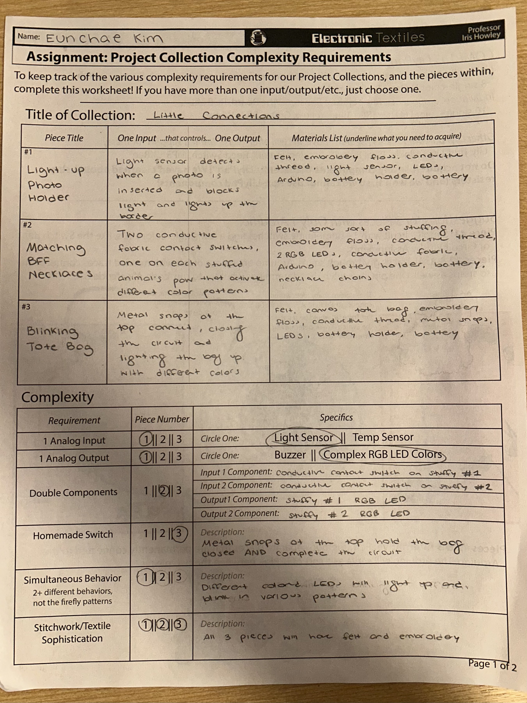
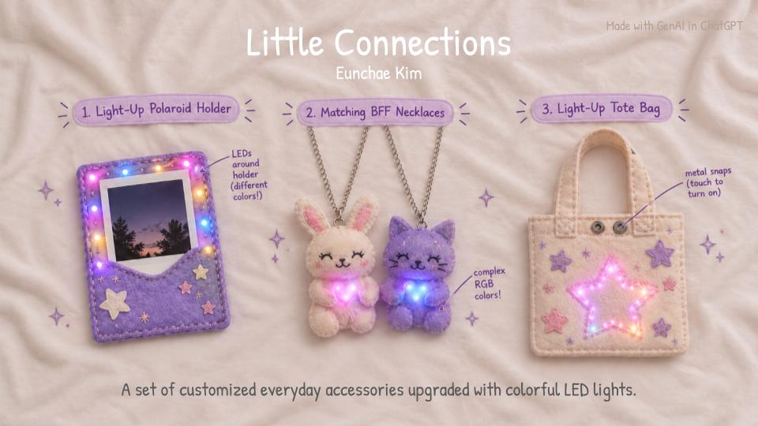
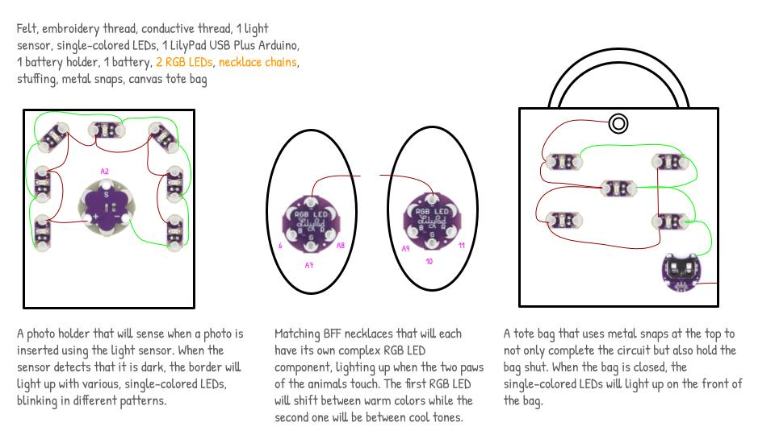

Description:
My collection is centered around the idea of memory and nostalgia. I wanted to create something that brought together pieces of my childhood and transformed them into something meaningful for the present. I drew inspiration from objects and experiences that were important to me growing up, such as friendship jewelry, photographs, and bags. I wanted to take these familiar childhood objects and reinterpret them through textiles and technology.

The photo holder will light up based on if there is a photo inserted into the holder or not, detecting darkness. The lights will also blink at different speeds and colors. The matching BFF necklaces will light up through the connection point between the two paws of the stuffed animals, with the RGB LEDs changing different colors. Last but not least, the tote bag will have a metal snap at the top, holding the bag closed and closing the circuit as well. It will simply turn on the LEDs, illuminating a night sky.
